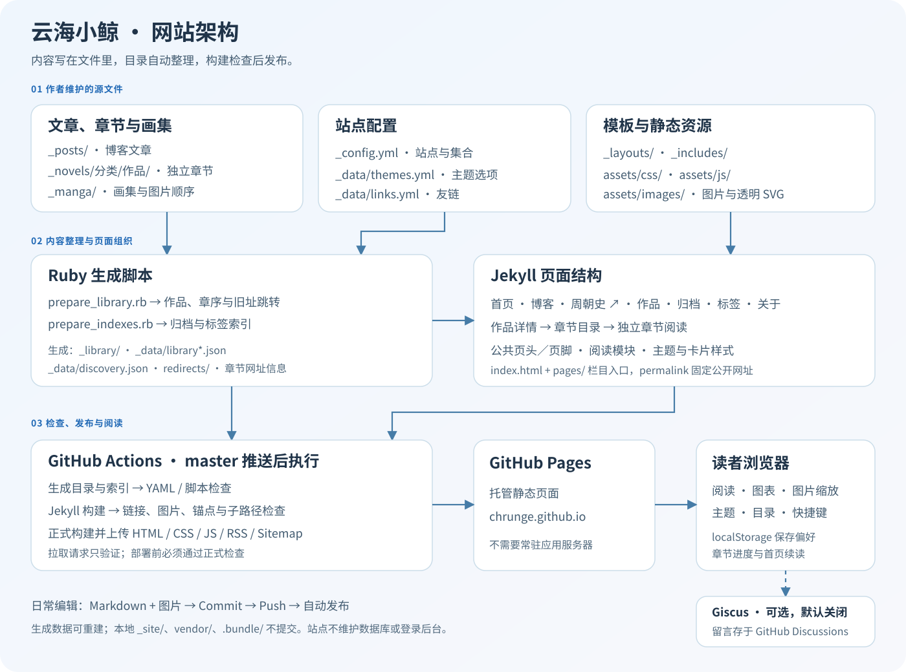

# 云海小鲸架构

本站是 Jekyll 静态网站。Markdown、YAML 和图片是源文件；Ruby 整理作品目录，Jekyll 生成索引与独立网址，浏览器脚本提供阅读交互。GitHub Pages 托管 HTML、CSS 和 JavaScript。

## 源码职责

| 位置 | 职责 |
| --- | --- |
| `_posts/` | 博客文章、随笔、阅读笔记 |
| `_novels/分类/作品/*.md` | 按目录组织作品，每份 Markdown 是一章 |
| `_manga/`、`assets/images/` | 漫画资料、图片顺序与素材 |
| `index.html`、`pages/` | 首页与栏目入口，公开网址由 `permalink` 指定 |
| `pages/timeline-legacy/` | 十一专题旧时间线地址的兼容入口，使用固定新目标并保留查询和分享Hash |
| `_layouts/` | 公共框架、正文、章节、作品详情、画集和跳转页 |
| `_includes/` | 页头、页脚、脚本入口、作品卡片、书架、画集网格、阅读工具、主题面板与评论 |
| `_config.yml`、`_data/*.yml` | 站点、主题选项、友链及缺省标签规则 |
| `scripts/lib/content.rb` | YAML 头部解析、发布判定、按变化写入及自有生成文件清理 |
| `_plugins/discovery.rb` | 构建期归档与标签索引，使用 Jekyll 文档的实际网址和发布判定 |

导航为：首页、博客、周朝史、作品、归档、标签、关于。周朝史链接独立站点；作品入口为 `/works/`。`/novels/`、`/manga/` 保留分类入口，正文和章节使用独立网址。栏目源文件位于 `pages/`，公开网址不包含这个源码目录。

## 内容准备与生成产物

`scripts/prepare_library.rb` 读取章节的目录和文件名，确定作品 ID、章序、章节网址、上下章链接及旧文章跳转。已有 `tags` 保持原值；标签缺失或为空时按 `_data/tag_rules.yml` 的第一个前缀匹配补齐。生成的章节资料字段写回源文件，正文的缩进、换行符和作者标签保留。书架、章数、导航及旧址跳转只包含可发布章节；没有公开章节的作品不生成入口。

`_plugins/discovery.rb` 在 Jekyll 构建期间读取可输出的文章、章节与画集，直接使用文档的 `url`、日期和发布判定，将归档与标签索引放入 `site.data.discovery`。索引不单独写入文件。

| 生成位置 | 用途 |
| --- | --- |
| `_library/` | 作品详情页入口 |
| `_data/library.json` | 作品及章节目录 |
| `_data/library_tree.json` | 分类书架树 |
| `redirects/` | `legacy_url` 对应的旧地址跳转页 |

这些产物由 `.gitignore` 排除，每次构建前从内容源生成。本地可以保留以便预览，不直接编辑或提交。生成器仅清理标有自身 `generated_by` 的过时文件；未托管或无法解析的文件保留并提示，作者内容的 YAML 校验保持严格。内容相同时不重写。首次克隆后必须先运行作品准备脚本，再启动 Jekyll。

## 样式与浏览器交互

| 文件 | 职责 |
| --- | --- |
| `assets/css/site.css` | 全站布局、导航、首页、卡片与续读入口 |
| `assets/css/themes.css` | 日间与夜间主题变量 |
| `assets/css/library.css` | 分类树、作品详情与章节导航 |
| `assets/css/reader.css` | 正文、目录、图表、画集及图片查看器 |
| `assets/js/site-init.js` | 样式前恢复主题，共享浏览器存储与快捷键判断 |
| `assets/js/site.js` | 主题面板、搜索、沉浸、图片失败重试及评论主题同步 |
| `assets/js/reading.js` | 字号、代码复制、目录、章节快捷键、阅读进度及续读 |
| `assets/js/gallery.js` | 连续／逐页切换、方向键与相邻图片预加载 |
| `assets/js/lightbox.js` | 原生 dialog 图片放大、缩放、拖动、焦点和滚动恢复 |
| `assets/js/diagrams.js` | Mermaid 识别、SVG 渲染、夜间重绘、失败兜底与放大入口 |
| `assets/js/redirect.js` | 旧网址跳转并保留章节锚点 |

主题选项由 `_data/themes.yml` 提供，布局传给初始化脚本。`_includes/scripts.html` 按页面类型加载交互模块。模块通过 `whale:theme`、`whale:layout`、`whale:zoom`、`whale:diagrams-ready` 事件衔接。

Markdown 和代码高亮由构建期 Kramdown GFM／Rouge 完成。仅含 Mermaid 代码块的页面从 jsDelivr 加载固定版本 11.12.0，严格模式渲染并移除图表链接；失败时保留源码与重试入口。

阅读记录保存在当前浏览器。按网址保存正文进度，按作品保存最后章节，最近阅读摘要只存 `version`、`url`、`progress`。首页使用构建目录校验地址并取得标题，显示一张续读卡片；清除记录保留主题和字号。自动恢复使用一个等待期限，等待字体、图片和图表就绪或超时。宽屏显示侧目录，手机和沉浸模式使用文内折叠目录。

Giscus 是默认关闭的独立评论服务；启用后留言保存在 GitHub Discussions。本站没有应用服务器、数据库或登录后台。

## 构建、检查与部署

工作流 `.github/workflows/jekyll-gh-pages.yml` 响应 `master` 推送、拉取请求及手动触发：

1. 安装 Ruby、Python、Node，并按 `Gemfile.lock` 安装固定的 Ruby 依赖；工作流启用冻结模式，不自动改写锁文件。
2. 检查内容解析与生成器，生成书架，检查 YAML、目录及脚本语法，并验证 Jekyll 索引与实际网址一致。
3. 构建期生成归档与标签索引，以 `/path-check` 构建并检查链接、图片、标题、ID、锚点与子路径。
4. 构建实际站点，执行相同的页面检查。
5. 验证实际生成的文章、章节、作品详情与画集布局，再运行独立阅读测试，复用上一步产物。测试资料由本地 HTTP 服务在内存中提供，截图放在被忽略的 `tests/artifacts/`，不会进入发布站点。
6. 推送及手动发布上传已经检查的站点产物并部署；拉取请求只验证。

`Gemfile.lock` 包含 Windows UCRT 与 Linux 平台；依赖升级需同步更新锁文件，并通过构建与阅读测试。

正常发布共两次 Jekyll 构建：子路径校验与实际站点。浏览器测试使用本地安装的固定版本 Mermaid，避免依赖 CDN 可用性；真实内容链接由 `check_site.py` 检查，阅读交互不依赖某篇文章标题或某个画集页数。

具体操作见[使用说明书](使用说明书.md)。所有维护过程记录在[维护历史](HISTORY.md)。
