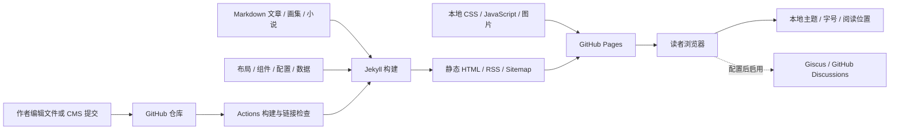

# 云海小鲸架构

| 层 | 文件 | 职责 |
| --- | --- | --- |
| 内容 | `_posts`、`_manga`、`_novels` | 唯一内容来源，生成列表和独立页面 |
| 布局 | `_layouts` | 页面框架、文章、小说和画集的阅读结构 |
| 组件 | `_includes` | 导航、主题面板、卡片、阅读工具、评论 |
| 配置 | `_config.yml`、`_data` | 站点信息、主题选项、友链 |
| 表现 | `assets/css/site.css`、`themes.css` | 响应式排版与主题颜色 |
| 增强 | `assets/js/theme-init.js`、`site.js` | 主题、搜索、沉浸、阅读工具 |
| 发布 | `.github/workflows/jekyll-gh-pages.yml` | Jekyll 构建、子路径检查和 Pages 发布 |

没有 JavaScript 时，导航、文章、作品仍能正常阅读；依赖脚本的按钮隐藏。前台没有管理口令，也没有以页面内存充当发布存储的逻辑。

本地存储仅保存阅读偏好，不能充当多人评论服务。评论由可选 Giscus 单独负责。后台由独立 CMS 负责，其认证不进入前台代码。

将来增加作品，只需增加内容文件。若小说发展成大量章节，可新增章节集合，按作品 ID 关联；现阶段使用页内章节目录。

## 分类书架与章节

`_posts` 负责博客文章；`_novels/分类/专题/*.md` 负责独立章节。`scripts/prepare_library.rb` 按目录生成 `_data/library.json`、目录树和 `_library` 作品入口。书架显示目录分类，作品详情显示章节，章节模板提供上下章导航。旧文章地址通过 `redirects` 保留。GitHub Actions 在正式构建前更新数据；所有页面仍可由标准 Jekyll 渲染，无额外服务。
